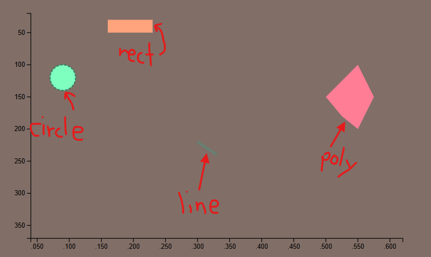

Assignment 1 - Hello World: GitHub and d3  
===
Link to GitHub Pages: https://kjhitt.github.io/a1-kjhitt-keagan-hitt/

This assignment takes a basic d3 example graph and adds the four required objects onto it, each using different colors. There is also some interactivity with it, as the objects rotate when hovered and get physics when clicked. There's also a fun little smiley face to the right of the graph. The graph area is intented as more of a technical showcase, whereas the area to the right is intended just as a drawing, although you can mess up the drawing by clicking on it a bunch.

Graph area:

Face:

Face when clicked on a bunch:

Code sources:
- index.html which was provided for this assignment.
- copied the example "D3 in vanilla HTML" from https://d3js.org/getting-started and modified it to change the axis scales and add required shapes
- code not directly copied, but referenced tutorial at https://d3-graph-gallery.com/graph/shape.html to find out how to add shapes to a d3 graph
- code not directly copied, but referenced https://d3-graph-gallery.com/graph/interactivity_tooltip.html#template for mouse interaction events

Technical Achievements
---
- Made it so that when an object is hovered, it rotates.
- Once an object is clicked, "gravity" affects it. Can be undone by clicking again. 
- Both technical achievements were completed with classes and JavaScript animations.

Design Achievements
---
- Utilized a color palette from Adobe's color palette tool to create appealing visuals and applied it to the website. Each color was consistently applied to the same shape.

- Made a smiley face out of the objects to the right of the graph.
- Included a dashed outline on the circle to make it visible when rotating or not.